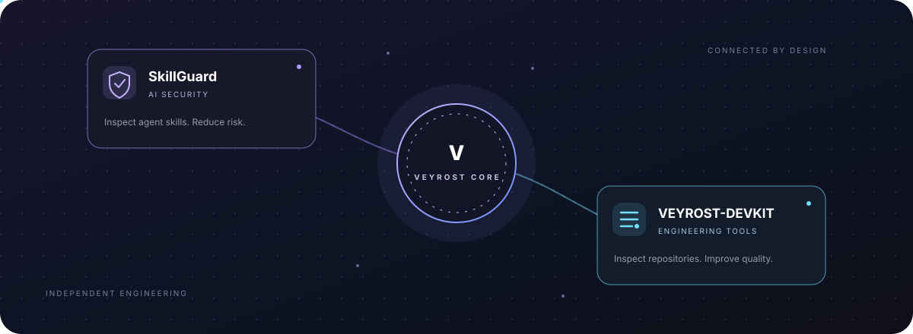

# VEYROST

  <strong>TECHNOLOGY · INTELLIGENCE · INDEPENDENT ENGINEERING</strong> 
  <em>Build useful technology. Connect ideas. Engineer what comes next.</em>

  
  
  
  

  

---

## The vision

**VEYROST is an independent technology initiative founded by Khayom Abdurahmonov in Tajikistan.**

It is being developed as an ecosystem, not a single application. The goal is to turn research, experimentation and engineering into useful software and systems—with clear documentation, honest product status and an emphasis on practical value.

The ecosystem begins with software, AI security and developer tooling. Its direction can expand as real projects are built and validated.

## The ecosystem

| Product | Domain | Purpose |
| --- | --- | --- |
| [SkillGuard](https://github.com/Khayom1/SkillGuard) | AI security | Local-first static security scanning for AI agent skills and their bundled files. |
| [VEYROST-DEVKIT](https://github.com/Khayom1/VEYROST-DEVKIT) | Developer tooling | Local-first repository health, quality and selected security checks with explainable reports. |
| [VEYROST Core](https://veyrost.is-a.dev/) | Ecosystem | The central identity, product directory and long-term engineering direction. |

### SkillGuard — AI security

SkillGuard inspects AI agent skill bundles for prompt-injection patterns, exposed secrets, hidden Unicode, risky execution chains, persistence mechanisms and permission concerns.

- Offline scanning; no API key required.
- Explainable findings with rule IDs, severity and file locations.
- CLI, JSON and SARIF reporting.
- Integrity lock and verification workflow.
- GitHub Actions integration.

**Repository:** https://github.com/Khayom1/SkillGuard

### VEYROST-DEVKIT — repository intelligence

VEYROST-DEVKIT helps developers understand the condition of a repository before they ship it.

- Repository hygiene and project-structure checks.
- Heuristic detection for selected exposed-secret patterns.
- Explainable health scoring and prioritized remediation.
- Text, JSON, Markdown, HTML and SVG reports.
- Local execution without sending repository contents to an external service.

**Repository:** https://github.com/Khayom1/VEYROST-DEVKIT

## Engineering principles

1. **Useful before impressive.** Every feature should solve a real problem.
2. **Local-first where practical.** Minimize unnecessary data transfer and external dependencies.
3. **Explainable by design.** Reports should tell people what was found and why it matters.
4. **Security is a process.** Heuristic scanners are helpful layers—not certifications or guarantees.
5. **Honest project status.** Released features, active work and future concepts must be clearly distinguished.
6. **Small, verifiable steps.** Tests, documentation and reproducible releases matter more than inflated claims.

## Current stage

VEYROST is an independent, early-stage technology initiative. SkillGuard and VEYROST-DEVKIT are separate public repositories with their own code, documentation, licenses and release histories. This repository connects them at the ecosystem and discovery level; it does not merge their source code or imply shared runtime dependencies.

## Official links

- **Website:** https://veyrost.is-a.dev/
- **Central repository:** https://github.com/Khayom1/Veyrost
- **SkillGuard:** https://github.com/Khayom1/SkillGuard
- **VEYROST-DEVKIT:** https://github.com/Khayom1/VEYROST-DEVKIT
- **Founder:** https://github.com/Khayom1

## Founder

**Khayom Abdurahmonov** — Founder of VEYROST.

VEYROST began as independent experimentation with limited resources. The operating principle remains simple:

> Build first. Verify what works. Improve what matters.

---

  <strong>VEYROST</strong> 
  Independent technology. Connected engineering. A larger horizon.

